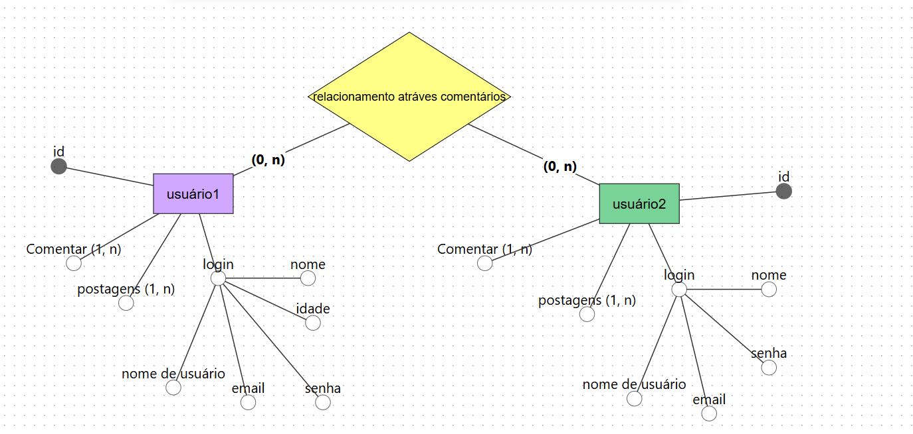
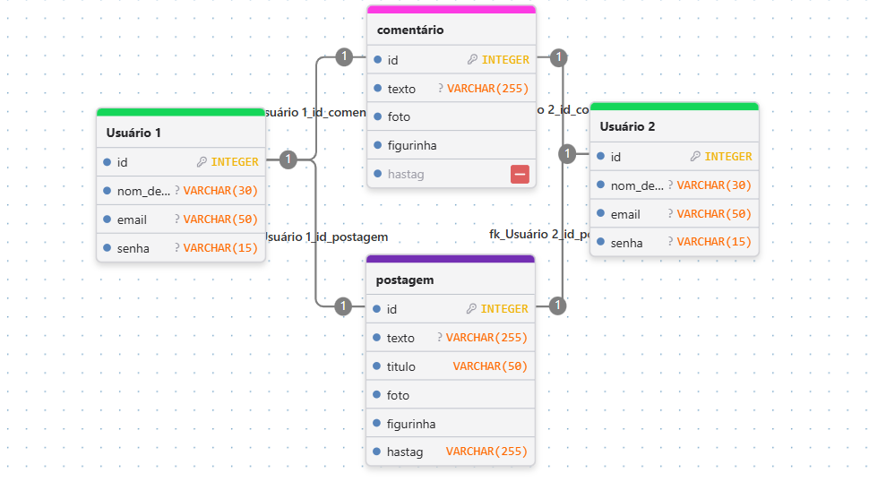

# Sistema de postagem e comentários

**Desenvolverdor do sitema:** Sanches

**Projeto de back end**

## 1. Sistema de postagem
Os usuário devem possuir cadstro para fazerem as postagens e comentarios em outros posts. 

## 2. Requisitos Funcionais(RF)

**RF01**-- Os usúarios para cadastrarem dentro do site deve ter:
- Nome
- email 
- nome de usuário
- Senha
- idade

**RF02**-- Os post podem ter seus postagens feitas após o cadastro assim também excluir e editar (*a edição só pode ser feita depois de 24 horas de postagem*)
- Nome de usuário (que fez a postagem) 
- ter titulo (opcional)
- texto  
- *publicar fotos, hashtag, fugurinhas, emoji*
- Data e hora da publicação

**RF03** -- Os comentários vão ser apenas de **texto, figurinhas, emoji e hashtag** e apenas esses tipos não podendo passar de 500 caracteres de palavras.
- Usuário que comentou (em relação a outra postagem) 
- Data e hora da publicação

# Modelos lógicos em fotos

